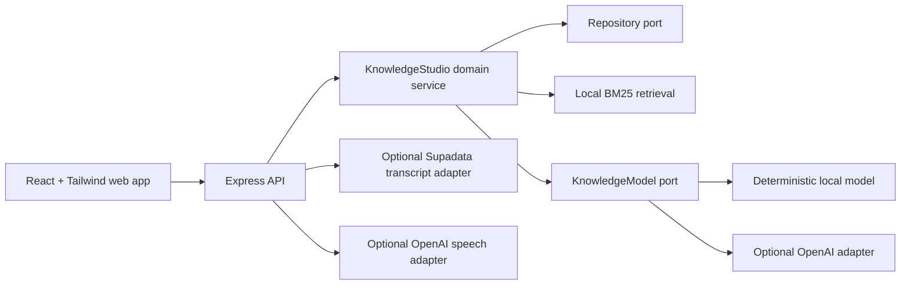

# 360GNH Knowledge Studio

> Import one YouTube video, preserve its raw transcript, edit it into a reusable source, then turn that source into cited learning tools or one audiobook file.

[](https://github.com/nguyenduyhung1989/360GNH/actions/workflows/ci.yml)
[](LICENSE)

360GNH is a provider-neutral TypeScript engine and local-first web demo extracted from the strongest reusable ideas in a privately maintained knowledge platform. It works without an API key by default, then lets maintainers opt into the OpenAI Responses API behind an explicit cost ceiling.


[Đọc bằng tiếng Việt](README.vi.md)

## Why this exists

Most “chat with your documents” demos stop at an answer. Knowledge Studio keeps the evidence visible and carries one source through a complete, inspectable workflow:

- single-video YouTube import through an optional Supadata adapter, with native captions and timestamps preserved;
- explicit transcript editing that always retains the raw source and flags suspicious compression or expansion;
- cited question answering with a local BM25 retriever;
- timestamp-preserving transcript chunks and smart clips;
- hierarchical mind maps with source excerpts;
- quizzes whose answers remain server-side until grading;
- mechanism-focused study guides;
- single-file WAV audiobook rendering through optional OpenAI speech, with sentence-aware splitting and hard character budgets;
- Agora debates where 2–4 distinct perspectives must ground claims in the source.

The deterministic local model makes the full vertical slice inspectable and testable without sending data to a third party. The optional OpenAI adapter adds schema validation, prompt-injection boundaries, transient-only retries, `store: false`, and concurrent budget reservations.

## Status

`0.1.0` is a pre-release extraction candidate. The demo is intentionally in-memory and single-process: restarting the API removes sources and quizzes. It is suitable for local evaluation and contribution, not yet for public multi-user hosting.

## Quick start

Requirements: Node.js 20 or newer and npm.

```bash
npm ci
npm run dev
```

Open <http://127.0.0.1:4311>. The API starts at <http://127.0.0.1:4310> and seeds an original Vietnamese learning-science fixture on first load.

Useful commands:

```bash
npm test
npm run eval
npm run check
```

## Optional OpenAI adapter

The default `mock` provider never needs a key. To test a real model, copy `.env.example` to `.env`, then set:

```dotenv
AI_PROVIDER=openai
OPENAI_API_KEY=your_key_here
OPENAI_MODEL=gpt-5.6-luna
AI_BUDGET_USD=1
```

The budget is process-local and reserves a conservative maximum before each request, so concurrent calls cannot all pass the same remaining-balance check. Prices for built-in model IDs are documented in code with a verification date; unknown models require explicit input and output rates.

Never commit `.env`. Knowledge-model calls send source text to OpenAI only when `AI_PROVIDER=openai`; speech sends the selected source only after a user explicitly starts audiobook rendering.

## Optional media workflow

The default demo still accepts pasted text without external services. Add these server-only values to enable the complete media path:

```dotenv
# Import one public YouTube video's native captions.
SUPADATA_API_KEY=your_key_here

# Also enables one-file speech rendering, even if AI_PROVIDER stays mock.
OPENAI_API_KEY=your_key_here
OPENAI_TTS_MODEL=gpt-4o-mini-tts
AUDIOBOOK_MAX_CHARS=20000
AUDIOBOOK_SESSION_CHAR_BUDGET=100000
```

The flow is deliberately explicit: import one video → inspect the raw transcript → press **Biên tập bằng AI** → reuse the clean source → render one WAV file. There is no playlist or bulk-download endpoint. Speech is AI-generated and must be disclosed to listeners.

## Architecture



The domain package has no dependency on Express or React. See [Architecture](docs/ARCHITECTURE.md) and [Threat model](docs/THREAT_MODEL.md).

## Deliberate scope

Included: the standalone Knowledge Studio engine, single-video transcript-to-clean-source workflow, single-file audiobook renderer, API, web demo, tests, and evals.

Not included:

- Study Groups — deliberately deferred until that module is stable and separately reviewed;
- tenant-specific authentication, profiles, permissions, or schemas from the originating private product;
- production data, customer content, credentials, or deployment configuration;
- playlist or bulk media downloaders, batch audiobook production, and other unrelated product modules;
- persistent storage and public multi-user authentication.

The extraction record is in [Provenance](docs/PROVENANCE.md).

## Security and privacy

- The API binds to loopback by default and refuses a non-loopback bind without `API_TOKEN`.
- `API_TOKEN` is for machine clients; it is not shipped inside the browser bundle and is not a replacement for user authentication.
- Ordinary source URLs remain metadata only. The dedicated YouTube route accepts only canonical public video URLs and calls fixed Supadata and YouTube oEmbed endpoints from the server.
- Source and query sizes are bounded; control and bidirectional characters are stripped.
- Retrieved source text is XML-escaped and marked as untrusted data before model calls.
- Quiz answer material is removed from the learner-facing response until grading.
- OpenAI Responses calls use `store: false` and a configurable cost ceiling.
- YouTube import, transcript editing, and audiobook rendering share a stricter expensive-operation rate limit; audiobook text is reserved against a process-local character budget before paid calls begin.

Please report vulnerabilities through [GitHub private vulnerability reporting](SECURITY.md), not a public issue.

## Contributing

Start with [CONTRIBUTING.md](CONTRIBUTING.md), then check the [roadmap](docs/ROADMAP.md). Small, source-grounded improvements are welcome. Large scope additions should begin as an issue so the project does not become a junk drawer with a logo.

## License

MIT © Nguyễn Duy Hưng. See [LICENSE](LICENSE).
