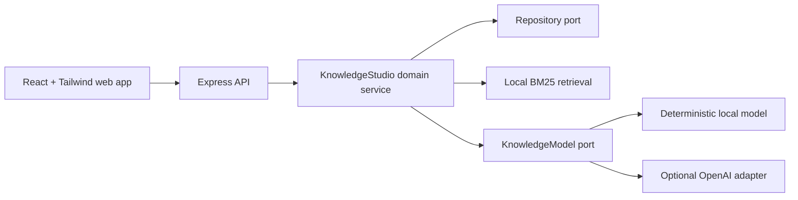

# 360GNH Knowledge Studio

> Turn long-form sources into cited answers, timestamped clips, quizzes, study guides, mind maps, and evidence-bound debates.

[](https://github.com/nguyenduyhung1989/360GNH/actions/workflows/ci.yml)
[](LICENSE)

360GNH is a provider-neutral TypeScript engine and local-first web demo extracted from the strongest reusable ideas in a privately maintained knowledge platform. It works without an API key by default, then lets maintainers opt into the OpenAI Responses API behind an explicit cost ceiling.


[Đọc bằng tiếng Việt](README.vi.md)

## Why this exists

Most “chat with your documents” demos stop at an answer. Knowledge Studio keeps the evidence visible and turns the same source into several learning artifacts:

- cited question answering with a local BM25 retriever;
- timestamp-preserving transcript chunks and smart clips;
- hierarchical mind maps with source excerpts;
- quizzes whose answers remain server-side until grading;
- mechanism-focused study guides;
- Agora debates where 2–4 distinct perspectives must ground claims in the source.

The deterministic local model makes the full vertical slice inspectable and testable without sending data to a third party. The optional OpenAI adapter adds schema validation, prompt-injection boundaries, transient-only retries, `store: false`, and concurrent budget reservations.

## Status

`0.1.0` is a pre-release extraction candidate. The demo is intentionally in-memory and single-process: restarting the API removes sources and quizzes. It is suitable for local evaluation and contribution, not yet for public multi-user hosting.

## Quick start

Requirements: Node.js 20 or newer and npm.

```bash
npm ci
npm run dev
```

Open <http://127.0.0.1:4311>. The API starts at <http://127.0.0.1:4310> and seeds an original Vietnamese learning-science fixture on first load.

Useful commands:

```bash
npm test
npm run eval
npm run check
```

## Optional OpenAI adapter

The default `mock` provider never needs a key. To test a real model, copy `.env.example` to `.env`, then set:

```dotenv
AI_PROVIDER=openai
OPENAI_API_KEY=your_key_here
OPENAI_MODEL=gpt-5.6-luna
AI_BUDGET_USD=1
```

The budget is process-local and reserves a conservative maximum before each request, so concurrent calls cannot all pass the same remaining-balance check. Prices for built-in model IDs are documented in code with a verification date; unknown models require explicit input and output rates.

Never commit `.env`. Source text is sent to OpenAI only when `AI_PROVIDER=openai` is selected.

## Architecture



The domain package has no dependency on Express or React. See [Architecture](docs/ARCHITECTURE.md) and [Threat model](docs/THREAT_MODEL.md).

## Deliberate scope

Included: the standalone Knowledge Studio engine, API, web demo, tests, and evals.

Not included:

- Study Groups — deliberately deferred until that module is stable and separately reviewed;
- tenant-specific authentication, profiles, permissions, or schemas from the originating private product;
- production data, customer content, credentials, or deployment configuration;
- playlist downloaders, audiobook pipelines, and other unrelated product modules;
- persistent storage and public multi-user authentication.

The extraction record is in [Provenance](docs/PROVENANCE.md).

## Security and privacy

- The API binds to loopback by default and refuses a non-loopback bind without `API_TOKEN`.
- `API_TOKEN` is for machine clients; it is not shipped inside the browser bundle and is not a replacement for user authentication.
- Submitted URLs are metadata only. The server does not fetch them, which removes the current server-side request forgery path.
- Source and query sizes are bounded; control and bidirectional characters are stripped.
- Retrieved source text is XML-escaped and marked as untrusted data before model calls.
- Quiz answer material is removed from the learner-facing response until grading.
- OpenAI requests use `store: false` and a configurable cost ceiling.

Please report vulnerabilities through [GitHub private vulnerability reporting](SECURITY.md), not a public issue.

## Contributing

Start with [CONTRIBUTING.md](CONTRIBUTING.md), then check the [roadmap](docs/ROADMAP.md). Small, source-grounded improvements are welcome. Large scope additions should begin as an issue so the project does not become a junk drawer with a logo.

## License

MIT © Nguyễn Duy Hưng. See [LICENSE](LICENSE).
