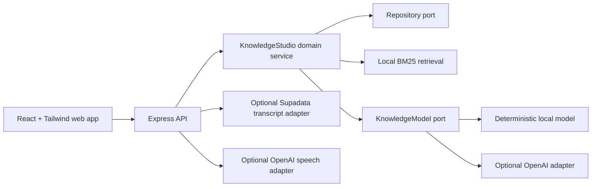

> Last verified: 2026-10-23 at commit 7647a3f

# 360GNH Knowledge Studio

**Languages:** English · [Tiếng Việt](README.vi.md)

> Import one YouTube video, preserve its raw transcript, edit it into a reusable source, then turn that source into cited learning tools or one audiobook file.

[](https://github.com/bke-edu/360GNH/actions/workflows/ci.yml)
[](LICENSE)

360GNH is a provider-neutral TypeScript engine and local-first web demo extracted from the strongest reusable ideas in a privately maintained knowledge platform. The complete interface is available in English and Vietnamese, remembers the reader's choice, and follows the browser language on first use. It works without an API key by default, then offers a server-backed setup screen for OpenAI and Supadata.


## Why this exists

Most “chat with your documents” demos stop at an answer. Knowledge Studio keeps the evidence visible and carries one source through a complete, inspectable workflow:

- single-video YouTube import through an optional Supadata adapter, with native captions and timestamps preserved;
- explicit transcript editing that always retains the raw source and flags suspicious compression or expansion;
- cited question answering with a local BM25 retriever;
- timestamp-preserving transcript chunks and smart clips;
- hierarchical mind maps with source excerpts;
- quizzes whose answers remain server-side until grading;
- mechanism-focused study guides;
- single-file WAV audiobook rendering through optional OpenAI speech, with sentence-aware splitting and hard character budgets;
- Agora debates where 2–4 distinct perspectives must ground claims in the source.

The deterministic local model makes the full vertical slice inspectable and testable without sending data to a third party. The optional OpenAI adapter adds schema validation, prompt-injection boundaries, transient-only retries, `store: false`, and concurrent budget reservations.

## Status

`0.1.0` is an early public release. Sources and quizzes are intentionally in-memory and single-process: restarting the API removes them. Provider settings alone persist in a private server-side file. The application is suitable for local evaluation and contribution, not yet for public multi-user hosting.

## Quick start

Requirements: Node.js 20 or newer and npm.

```bash
npm ci
npm run dev
```

Open <http://localhost:4311>. The API starts at <http://localhost:4310> and seeds an original bilingual learning-science fixture on first load. A key-free installation opens provider setup once and still lets you enter the local demo. Reopen it later with the settings button in the header. Use the **VI / EN** control to switch the entire interface; local model outputs follow the query language.

Useful commands:

```bash
npm test
npm run eval
npm run check
```

### Keep it running with Docker

Docker Compose builds a non-root API container and a separate static web container. Both bind to loopback and use `restart: unless-stopped`, so they return automatically whenever Docker starts. The browser reaches the protected API through the web proxy; provider keys never enter the web bundle or image layers. Keys entered in the interface persist in an API-only named volume as an atomic `0600` file.

For the key-free local model:

```bash
cp .env.example .env
./scripts/docker-up.sh
```

The helper generates a fresh internal `API_TOKEN` when none is already set. If you invoke Compose directly instead, set that value yourself. Open the settings screen to verify and save OpenAI or Supadata keys; no environment-file editing is required.

Environment variables remain available for headless operation and always override interface-managed keys. To reuse an existing private environment file without copying its keys into this repository:

```bash
AI_PROVIDER=openai ./scripts/docker-up.sh "$PRIVATE_ENV_FILE"
```

Set `PRIVATE_ENV_FILE` locally to the path of the private environment file before running this command. Do not copy its contents into the repository.

Open <http://localhost:4311>. Check status with `docker compose ps`; view bounded logs with `docker compose logs --tail 100`. Rebuild only after source or dependency changes. The current in-memory adapter still loses imported sources when the API container restarts.

## Provider setup and optional OpenAI adapter

The default `mock` provider never needs a key. The easiest real-model path is the settings button in the header: enter a key, choose the knowledge and speech models, set the process-local cost ceiling, then press **Verify and save OpenAI**. Verification reads model metadata and does not generate billable content; it proves key validity and model visibility, not permission to call Responses or speech. Those endpoint permissions are checked by the first real operation. The API writes only after verification succeeds, switches providers without restarting, and returns only a four-character hint.

For headless configuration, copy `.env.example` to `.env`, then enter your own key locally in the blank value below:

```dotenv
AI_PROVIDER=openai
OPENAI_API_KEY=
OPENAI_MODEL=gpt-5.6-luna
AI_BUDGET_USD=1
```

The budget is process-local and reserves a conservative maximum before each request, so concurrent calls cannot all pass the same remaining-balance check. Provider changes preserve spent and reserved usage until the API process restarts. Prices for built-in model IDs are documented in code with a verification date; unknown models require explicit input and output rates.

Never commit `.env` or the generated provider-settings file. Environment credentials are shown as server-managed and cannot be replaced or deleted through the web interface. Knowledge-model calls send source text to OpenAI only when the OpenAI model is active; speech sends the selected source only after a user explicitly starts audiobook rendering.

## Optional media workflow

The default demo still accepts pasted text without external services. Supadata can also be verified and saved from the settings screen; its check uses a documented free job-status request. For headless setup, add these server-only values:

```dotenv
# Import one public YouTube video's native captions.
SUPADATA_API_KEY=

# Also enables one-file speech rendering, even if AI_PROVIDER stays mock.
OPENAI_API_KEY=
OPENAI_TTS_MODEL=gpt-4o-mini-tts
AUDIOBOOK_MAX_CHARS=20000
AUDIOBOOK_SESSION_CHAR_BUDGET=100000
```

The flow is deliberately explicit: import one video → inspect the raw transcript → press **Edit with AI** → reuse the clean source → render one WAV file. There is no playlist or bulk-download endpoint. Speech is AI-generated and must be disclosed to listeners.

## Architecture

Repository profile: [overview](docs/00-overview.md), [architecture](docs/01-architecture.md), [interfaces](docs/02-api.md), [data and persistence](docs/03-database.md), [deployment](docs/04-deployment.md), [security](docs/05-security.md), and [roadmap](docs/06-roadmap.md).



The domain package has no dependency on Express or React. See [Architecture](docs/ARCHITECTURE.md) and [Threat model](docs/THREAT_MODEL.md).

## Deliberate scope

Included: the standalone Knowledge Studio engine, single-video transcript-to-clean-source workflow, single-file audiobook renderer, API, web demo, tests, and evals.

Not included:

- Study Groups, deliberately deferred until that module is stable and separately reviewed;
- tenant-specific authentication, profiles, permissions, or schemas from the originating private product;
- production data, customer content, credentials, or deployment configuration;
- playlist or bulk media downloaders, batch audiobook production, and other unrelated product modules;
- persistent storage and public multi-user authentication.

The extraction record is in [Provenance](docs/PROVENANCE.md).

## Legal boundary

The MIT license covers original 360GNH project code and documentation, not material that users import. Public availability does not automatically grant permission to republish a video transcript, translation, or audiobook. Operators must have a lawful basis for processing content and must comply with the current terms of the providers they enable.

See [Legal and responsible-use notes](docs/LEGAL.md), [Provenance](docs/PROVENANCE.md), and [Third-party notices](THIRD_PARTY_NOTICES.md). A compiled web distribution must include the bundled font, icon, and React notices under `docs/licenses/`.

## Security and privacy

- The API binds to loopback by default and refuses a non-loopback bind without `API_TOKEN`.
- `API_TOKEN` is for machine clients; it is not shipped inside the browser bundle and is not a replacement for user authentication.
- Ordinary source URLs remain metadata only. The dedicated YouTube route accepts only canonical public video URLs and calls fixed Supadata and YouTube oEmbed endpoints from the server.
- Source and query sizes are bounded; control and bidirectional characters are stripped.
- Retrieved source text is XML-escaped and marked as untrusted data before model calls.
- Quiz answer material is removed from the learner-facing response until grading.
- OpenAI Responses calls use `store: false` and a configurable cost ceiling.
- Provider setup uses authenticated `PUT`/`DELETE` routes, never returns complete keys, and writes an atomic `0600` file in an API-only volume. Host or Docker administrators can still read local server secrets.
- YouTube import, transcript editing, and audiobook rendering share a stricter expensive-operation rate limit; audiobook text is reserved against a process-local character budget before paid calls begin.

Please report vulnerabilities through [GitHub private vulnerability reporting](SECURITY.md), not a public issue.

## Contributing

Start with [CONTRIBUTING.md](CONTRIBUTING.md), then check the [roadmap](docs/ROADMAP.md). Small, source-grounded improvements are welcome. Large scope additions should begin as an issue so the project does not become a junk drawer with a logo.

## License

MIT © Nguyễn Duy Hưng. See [LICENSE](LICENSE). Dependencies and embedded assets retain the licenses listed in [Third-party notices](THIRD_PARTY_NOTICES.md).
