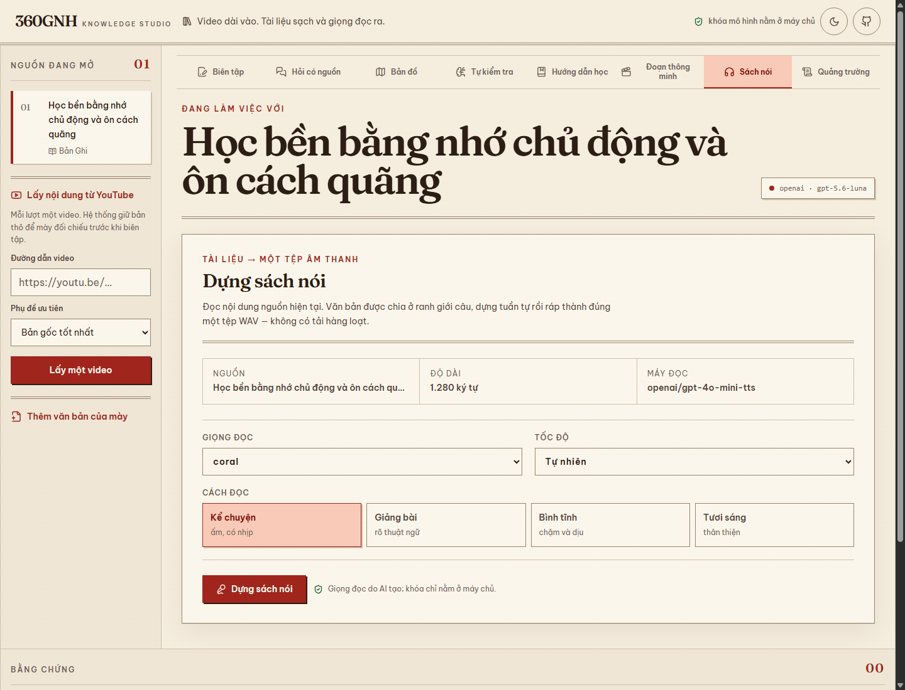

# 360GNH Knowledge Studio

360GNH lấy nội dung từ một video YouTube, giữ nguyên bản phụ đề thô, biên tập thành tài liệu sạch rồi biến cùng nguồn đó thành câu trả lời có trích dẫn, công cụ học hoặc một tệp sách nói.

Đây là bản tách độc lập từ các ý tưởng dùng lại được của một nền tảng tri thức do Nguyễn Duy Hưng duy trì. Mặc định dự án chạy hoàn toàn cục bộ bằng mô hình giả lập có kết quả ổn định, không cần khóa API và không gửi dữ liệu ra ngoài.



## Chạy thử

Cần Node.js 20 trở lên và npm.

```bash
npm ci
npm run dev
```

Mở <http://127.0.0.1:4311>. Máy chủ API chạy tại <http://127.0.0.1:4310>.

```bash
npm test
npm run eval
npm run check
```

## Có gì bên trong

- hỏi đáp bám nguồn bằng bộ tìm kiếm BM25 cục bộ;
- lấy phụ đề gốc có mốc thời gian từ từng video YouTube qua Supadata;
- chỉ biên tập khi người dùng bấm nút, luôn giữ bản thô và cảnh báo khi bản sạch bị co hoặc phình đáng ngờ;
- giữ mốc thời gian của bản ghi lời nói và tạo đoạn thông minh;
- bản đồ ý nhiều tầng có đoạn nguồn đi kèm;
- bài kiểm tra giữ đáp án ở máy chủ cho tới lúc chấm;
- hướng dẫn học tập trung vào cơ chế, không chỉ tóm tắt;
- dựng một tệp sách nói WAV qua OpenAI, tự chia ở ranh giới câu và chặn cứng số ký tự;
- Quảng trường tranh luận với 2–4 góc nhìn bắt buộc dựa vào bằng chứng.

Muốn dùng OpenAI cho biên tập và các công cụ tri thức thì chép `.env.example` thành `.env`, đặt `AI_PROVIDER=openai`, thêm `OPENAI_API_KEY` và chọn giới hạn `AI_BUDGET_USD`. Văn bản chỉ được gửi cho mô hình tri thức khi người vận hành bật lựa chọn này; sách nói chỉ gửi nguồn đã chọn sau khi người dùng tự bấm dựng.

Để bật trọn luồng video và sách nói, thêm các giá trị chỉ nằm ở máy chủ:

```dotenv
SUPADATA_API_KEY=your_key_here
OPENAI_API_KEY=your_key_here
OPENAI_TTS_MODEL=gpt-4o-mini-tts
AUDIOBOOK_MAX_CHARS=20000
AUDIOBOOK_SESSION_CHAR_BUDGET=100000
```

Luồng được cố ý giữ rõ ràng: nhập một video → xem bản thô → tự bấm biên tập → tái dùng bản sạch → dựng một tệp WAV. Không có tải danh sách phát, tải hàng loạt hay sản xuất sách nói hàng loạt. Giọng đọc do AI tạo phải được thông báo cho người nghe.

## Phạm vi cố ý chưa làm

Study Groups chưa được đưa vào 360GNH cho tới khi mô-đun đó ổn định và được rà soát riêng. Dự án cũng không chứa xác thực theo khách hàng, dữ liệu sản xuất, trình tải danh sách phát, xử lý âm thanh hàng loạt, cấu hình triển khai riêng hay bí mật của sản phẩm gốc.

Bản `0.1.0` chỉ dùng bộ nhớ trong tiến trình, chưa có lưu trữ bền vững và chưa phù hợp để mở thành dịch vụ nhiều người dùng trên Internet.

Đọc thêm: [kiến trúc](docs/ARCHITECTURE.md), [mô hình đe dọa](docs/THREAT_MODEL.md), [nguồn gốc mã](docs/PROVENANCE.md), [lộ trình](docs/ROADMAP.md).

Giấy phép: [MIT](LICENSE).
