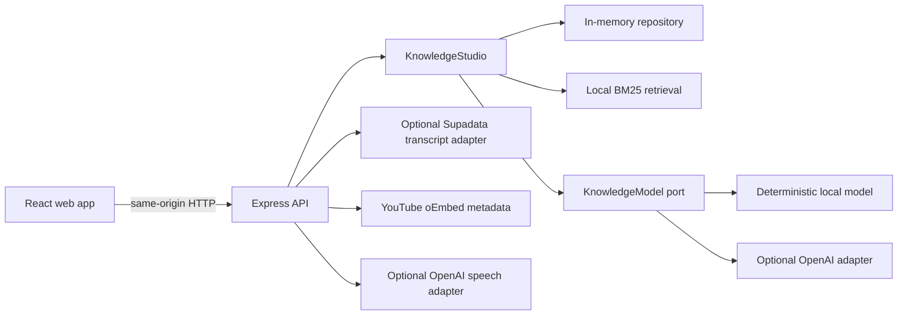

> Last verified: 2026-10-23 at commit 7647a3f

# 360GNH Knowledge Studio Architecture

## Boundaries and components

| Component | Responsibility | Calls or owns | Evidence |
|---|---|---|---|
| `packages/core` | Source lifecycle, chunking, BM25 retrieval, citations, learning artifacts, and debate orchestration | `KnowledgeRepository`, `KnowledgeModel`, and transcript provider ports | `packages/core/src/studio.ts`, `packages/core/src/model.ts`, `packages/core/src/repository.ts` |
| `apps/api` | HTTP validation, authentication hook, rate limits, provider settings, YouTube adapter, and speech adapter | Core package and optional external providers | `apps/api/src/app.ts`, `apps/api/src/server.ts`, `apps/api/src/provider-registry.ts` |
| `apps/web` | Bilingual user interface and browser state | HTTP API | `apps/web/src/App.tsx`, `apps/web/src/lib/api.ts` |
| `packages/core/scripts/eval.ts` | Deterministic core capability evaluation | Core package with in-memory repository and mock model | `packages/core/scripts/eval.ts` |

## Main flow

The web container serves static assets and proxies API traffic to the API container in the local Compose stack. See `compose.yaml` and `apps/web/nginx.conf.template`.

## Startup or execution sequence

1. `apps/api/src/server.ts` loads environment configuration and bootstraps `ProviderSettingsService`.
2. The settings service constructs the current provider registry. Environment credentials take precedence; stored provider settings are used when no environment override exists.
3. The API creates `KnowledgeStudio` with `InMemoryKnowledgeRepository` and the registry as its model port, then registers routes in `apps/api/src/app.ts`.
4. The web development server calls the API; in Compose, Nginx serves the compiled web app and supplies the server-only API token to proxied requests.

## Important invariants

- Core domain code depends on ports, not Express or React. Provider adapters remain outside `packages/core` unless they are provider-neutral interfaces.
- Source text and query input are bounded and sanitized. Retrieved source text is escaped and marked as untrusted before model calls.
- Imported raw transcript text remains available after an explicit edit; the edited text becomes the searchable version.
- The learner-facing quiz shape omits answers and explanations until grading.
- Model cost and speech character reservations are process-local and happen before paid provider work.

Evidence: `packages/core/src/studio.ts`, `packages/core/src/security.ts`, `packages/core/src/types.ts`, `packages/core/src/audiobook.ts`, `apps/api/src/app.ts`, and `docs/ARCHITECTURE.md`.

## Change impact

| Change area | Likely affected components | Evidence to inspect |
|---|---|---|
| Source or chunk shape | Core types, ingestion, retrieval, API schemas, and browser types | `packages/core/src/types.ts`, `packages/core/src/studio.ts`, `apps/api/src/app.ts`, `apps/web/src/lib/types.ts` |
| Model capability | Core model port, provider adapters, API registry, web controls, and eval cases | `packages/core/src/model.ts`, `packages/core/src/providers/`, `apps/api/src/provider-registry.ts`, `packages/core/scripts/eval.ts` |
| Provider setup | API settings service, registry snapshots, settings routes, and settings UI | `apps/api/src/provider-settings.ts`, `apps/api/src/provider-registry.ts`, `apps/api/src/app.ts`, `apps/web/src/lib/useProviderSettings.ts` |
| Transcript import | URL canonicalization, core import flow, Supadata adapter, and source UI | `packages/core/src/youtube.ts`, `packages/core/src/studio.ts`, `apps/api/src/supadata-transcript.ts`, `apps/web/src/components/SourceRail.tsx` |
| Local container delivery | Compose, Dockerfile, Nginx proxy, and startup helper | `compose.yaml`, `Dockerfile`, `apps/web/nginx.conf.template`, `scripts/docker-up.sh` |

The detailed provider setup and one-video import flows are documented in [focused specifications](specs/provider-settings.md) and [the YouTube import specification](specs/youtube-transcript-import.md).

## Open questions

- A production deployment target, its owner, and a rollback procedure are Unknown (not found in repository).
